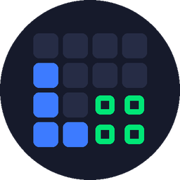
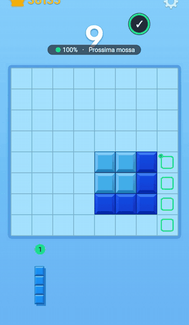
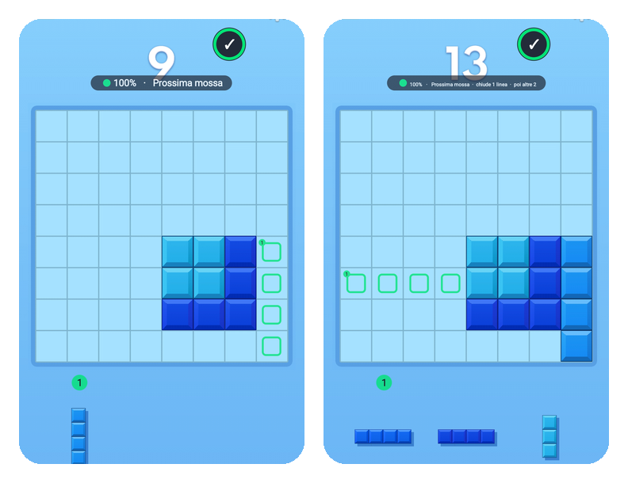

<h1 align="center">BB Helper</h1>

<b>An Android helper for Block Blast: it shows you where to place the pieces, right on top of the game.</b> 
<i>Un aiuto per Block Blast su Android: ti mostra dove mettere i pezzi, direttamente sopra il gioco.</i> — <a href="#-italiano">🇮🇹 Italiano</a>

  
  
  
  

> **Unofficial project.** BB Helper is a free, independent tool and is not affiliated with, endorsed by or connected to the developers of Block Blast. "Block Blast" is a trademark of its respective owner.

## ✨ Features

- **Live hints on top of the game** — colored boxes show exactly where each piece goes, and a number above the piece in the tray tells you which one to take.
- **Thinks ahead** — it tries every order and position for your 3 pieces, then tests the best options against the pieces that might come next.
- **Survival meter** — a green / yellow / red dot with the probability that the next set of pieces will still fit.
- **Instant next move** — if you play the suggested move, the next one is already computed and appears immediately.
- **Two modes** — *Survival* (last as long as possible) or *Score* ★ (goes for combos and multi-line clears). Double-tap the bubble to switch.
- **Automatic mode** — turn it on once in Accessibility settings: the helper appears by itself only inside the game, with no screen-recording prompt every time.
- **Dashboard** — your stats and charts inside the app: most frequent pieces, lines per move and per game, survival over time, and *"does the game help you?"*.
- **Works with every theme** — grey, purple, light blue… it recognizes empty and filled cells by their shape, not their color.
- **In-app updates**, English and Italian (follows your phone, or pick it in Settings), diagnostics with one-tap bug reports.

## 📲 Install

**Option A — direct download**
1. Open the [**latest release**](../../releases/latest) on your phone and download `BlockBlastHelper.apk`.
2. Open the file. Android will ask you to allow installs from your browser / file manager: allow it.
   If **Play Protect** shows a warning, tap *"Scan app"* or *"Install anyway"* — it appears for every app that doesn't come from the Play Store.
3. Open **BB Helper** and follow the 3 welcome screens.

**Option B — automatic updates with [Obtainium](https://github.com/ImranR98/Obtainium)**
Obtainium installs apps straight from GitHub releases and keeps them updated.
1. Install Obtainium.
2. On your phone, tap [**Add BB Helper to Obtainium**](http://apps.obtainium.imranr.dev/redirect.html?r=obtainium://add/https://github.com/vantaggioriccardo0604-wq/blockblast-helper) — or in Obtainium tap *Add App* and paste
   `https://github.com/vantaggioriccardo0604-wq/blockblast-helper`
3. Tap *Add*, then *Install*. Obtainium will notify you when a new version is out.

Requires **Android 8.0+** (automatic mode needs **Android 11+**).

## 🎮 How to use it

**Automatic mode (recommended)**
1. In the app tap **"Open Accessibility settings"** and turn on **"BB Helper (automatic mode)"**.
2. If the switch is grey or says *"restricted setting"*: Settings → Apps → BB Helper → ⋮ → *"Allow restricted settings"*, then try again.
3. Open Block Blast. That's it.

**Manual mode** — tap **"Start helper"**, allow *"Display over other apps"* and choose *"Entire screen"* when Android asks to record the screen.

**The floating bubble:** tap = pause · double tap = score/survival mode · drag = move it · long press = close.
Blue = looking for the board · orange = thinking · green = hint ready.

## 🔒 Privacy

- The app looks at the screen **only to recognize the game**. Each screenshot is analyzed in memory and discarded immediately; **images are never saved**.
- **No data leaves your phone.** The app only connects to the internet when *you* tap "Update" (to check GitHub for a new version).
- Only game statistics (pieces, moves, lines) are stored on the phone. You can delete them any time: Settings → Apps → BB Helper → Storage → Clear data.
- In automatic mode the Accessibility service does **not** read text, passwords or content of other apps (`canRetrieveWindowContent="false"`); it only uses screenshots while the game is open.

## 🛠 How it works

| Part | What it does |
|---|---|
| [`Analyzer`](app/src/main/java/com/bbhelper/Analyzer.java) | Finds the 8×8 board by aligning its grid lines, tells filled cells from empty ones by their bevel (so it works with any theme), and reads the 3 pieces in the tray. |
| [`Solver`](app/src/main/java/com/bbhelper/Solver.java) | Tries all orders and positions using 64-bit bitboards, scores boards (open space, isolated holes, edges), checks which of 37 common pieces would still fit, then simulates the next turn for the best candidates. |
| [`Engine`](app/src/main/java/com/bbhelper/Engine.java) | The loop: capture → recognize → compute → draw, with move prediction for instant follow-up hints. |
| [`Tracker`](app/src/main/java/com/bbhelper/Tracker.java) | Detects the move you made by comparing boards, for stats and the dashboard. |

Strategy weights were tuned with thousands of simulated games. Every release runs **automated tests** on GitHub first (real screenshots of every theme, move tracking, dashboard math and a simulated tournament) — results are in each release's notes.

## 🐞 Problems?

In the app: **Updates and problems → "Report a problem on GitHub"** opens a pre-filled issue with a diagnostic report (app version, phone, timings, recent errors). Or [open an issue](../../issues/new/choose) yourself — a screenshot or a short screen recording helps a lot.

## 📄 License

[MIT](LICENSE) — free to use, modify and share.

---

## 🇮🇹 Italiano

**BB Helper** ti mostra dove mettere i pezzi in Block Blast, con riquadri colorati direttamente sopra la griglia.

> **Progetto non ufficiale.** BB Helper è uno strumento gratuito e indipendente, non affiliato con gli sviluppatori di Block Blast.

**Cosa fa**
- Riquadri colorati sulla griglia e un numero sopra il pezzo da prendere.
- Pensa anche ai pezzi che potrebbero arrivare dopo.
- Pallino verde / giallo / rosso con la probabilità di sopravvivere al turno successivo.
- Mossa successiva istantanea se segui il suggerimento.
- Modalità *sopravvivenza* o *punteggio* ★ (doppio tocco sulla bolla).
- Modalità automatica: si attiva una volta sola e l'aiuto compare da solo dentro il gioco.
- Dashboard con statistiche e grafici, funziona con tutti i temi, aggiornamenti dentro l'app.
- In italiano o in inglese: segue la lingua del telefono, oppure la scegli nelle Impostazioni.

**Installazione**
1. Apri l'[**ultima versione**](../../releases/latest) dal telefono e scarica `BlockBlastHelper.apk`
   (oppure usa [**Obtainium**](http://apps.obtainium.imranr.dev/redirect.html?r=obtainium://add/https://github.com/vantaggioriccardo0604-wq/blockblast-helper) per ricevere gli aggiornamenti in automatico).
2. Aprilo e consenti l'installazione. Se compare **Play Protect**, tocca *"Analizza l'app"* o *"Installa comunque"*: succede con ogni app che non viene dal Play Store.
3. Apri **BB Helper** e segui le 3 schermate iniziali.

**Modalità automatica:** nell'app tocca *"Apri impostazioni Accessibilità"* e attiva *"BB Helper (modalità automatica)"*. Se l'interruttore è grigio: Impostazioni → App → BB Helper → ⋮ → *"Consenti impostazioni limitate"*.

**Bolla:** tocca = pausa · doppio tocco = punteggio/sopravvivenza · trascina = sposta · tieni premuto = chiudi.

**Privacy:** le immagini dello schermo vengono analizzate sul momento e mai salvate; nessun dato esce dal telefono (internet solo quando tocchi "Aggiorna"); sul telefono restano solo le statistiche di gioco, che puoi cancellare da Impostazioni → App → BB Helper → Spazio → Cancella dati.

**Problemi?** Nell'app: *Aggiornamenti e problemi → "Segnala un problema su GitHub"*, oppure [apri una segnalazione](../../issues/new/choose).
